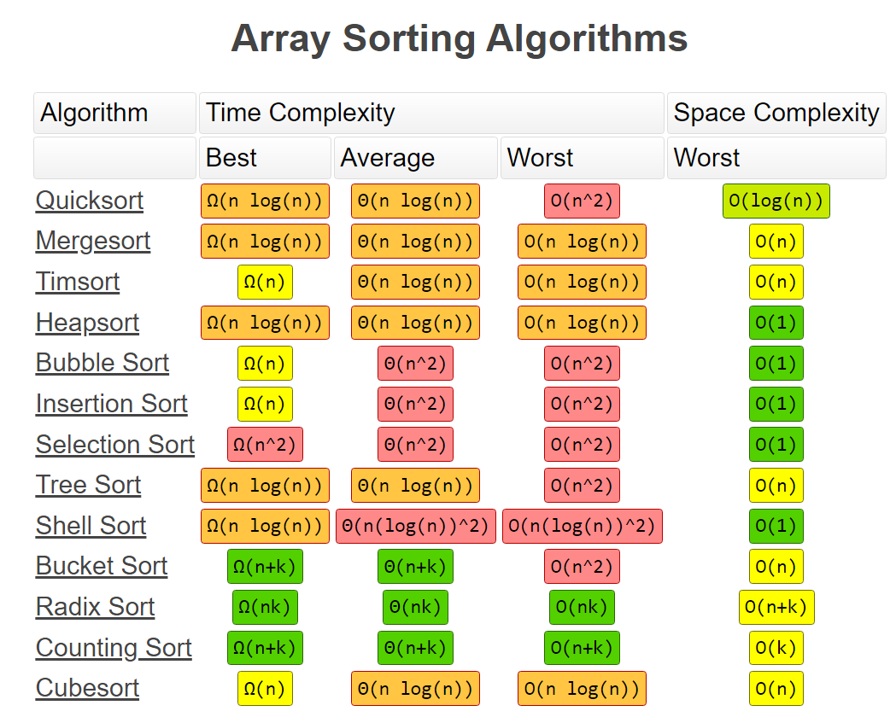

# Sorting · Guide

[← All topics](../../README.md) &nbsp;·&nbsp; **Guide** &nbsp;·&nbsp; [Problems](problems.md) &nbsp;·&nbsp; [Solutions](solutions.md)

- **LeetCode Problems**: [Full List](https://leetcode.com/problemset/all/?topicSlugs=sorting&page=1)
- **Reference 1**: [Sorting Algorithms - GeeksforGeeks](https://www.geeksforgeeks.org/sorting-algorithms/)
- **Reference 2**: [Python 3 Sorting Algorithms](https://leetcode.com/problems/sort-an-array/discuss/461394/Python-3-(Eight-Sorting-Algorithms)-(With-Explanation))

---

## Sorting Algorithms




- Example Problem: [912. Sort an Array](https://leetcode.com/problems/sort-an-array/)

### Quick Sort

```python
class Solution:
    def sortArray(self, nums: List[int]) -> List[int]:

        # Quick Sort:

        # Picks an element (leftmost element) as pivot and partitions the given array around the pivot
        # YouTube: https://youtu.be/7h1s2SojIRw

        def partition(array, low, high):

            l, r = low, high
            pivot = array[low]
            l += 1

            while l <= r:

                if array[l] > pivot and array[r] < pivot:
                    array[l], array[r] = array[r], array[l]

                if not array[l] > pivot: # find first occurrence from left > pivot
                    l += 1
                if not array[r] < pivot: # find first occurrence from right < pivot
                    r -= 1

            # now r is at the left of l, swap pivot with array[h]
            array[low], array[r] = array[r], array[low]

            return r # return position from where partition is done

        def quick_sort(array, low, high):

            if low < high:
                pi = partition(array, low, high)
                quick_sort(array, low, pi - 1)
                quick_sort(array, pi + 1, high)

        quick_sort(nums, 0, len(nums) - 1)

        return nums
```

---

### Merge Sort

```python
class Solution:
    def sortArray(self, nums: List[int]) -> List[int]:

        # Merge Sort:

        # Divide into two equal halfs, and combine in a sorted manner
        # Ref: https://www.geeksforgeeks.org/merge-sort/

        def merge_sort(array):

            if len(array) == 1:
                return array

            mid = len(array) // 2
            L = array[:mid]
            R = array[mid:]

            L = merge_sort(L)
            R = merge_sort(R)

            return merge(L, R)

        def merge(A, B):
            i, j = 0, 0
            merged = []

            while i < len(A) and j < len(B):
                if A[i] <= B[j]:
                    merged.append(A[i])
                    i += 1
                else:
                    merged.append(B[j])
                    j += 1

            if i < len(A):
                merged += A[i:]
            if j < len(B):
                merged += B[j:]

            return merged

        return merge_sort(nums)
```

---

### Counting Sort

```python
class Solution:
    def sortArray(self, nums: List[int]) -> List[int]:

        # Counting Sort:

        # Using counter and just replacing the values in the list

        def count_sort(array):
            cnt = Counter(array)
            result = []

            m, M = min(array), max(array)

            for i in range(m, M + 1):
                if i in cnt:
                    for _ in range(cnt[i]):
                        result.append(i)

            return result

        return count_sort(nums)
```

---

### Heap Sort

```python
class Solution:
    def sortArray(self, nums: List[int]) -> List[int]:

        # Heap Sort:

        # Using heapq
        # Ref: https://docs.python.org/3/library/heapq.html#basic-examples

        def heap_sort(array):
            import heapq

            result = []
            heapq.heapify(array)

            for _ in range(len(array)):
                result.append(heapq.heappop(array))

            return result

        return heap_sort(nums)

```

---
